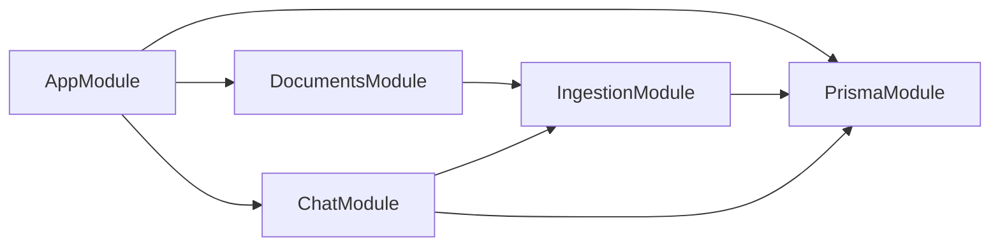
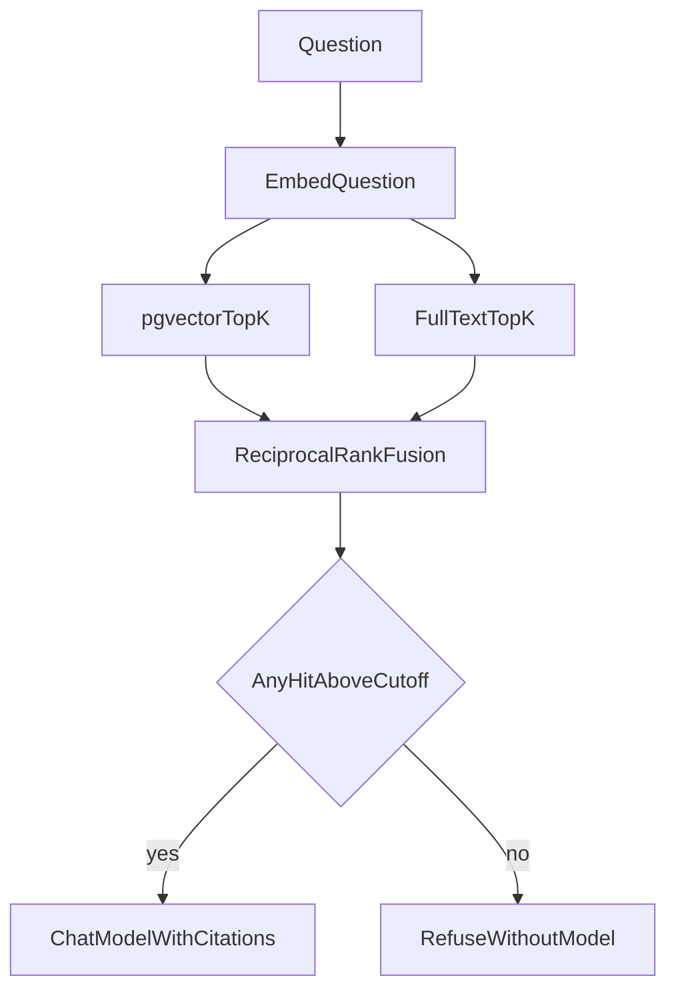

# Internal company RAG

Internal RAG answers questions from one company's documents. It chunks text, embeds changed text, answers only from the retrieved passages, and refuses when nothing is close enough.

Work follows the five phases below. Each phase is usable before the next one starts. Login and permissions come after chat and data management work.

## Status

| Phase | Scope | Status |
| --- | --- | --- |
| 1.1 | NestJS API, Vite React app, Postgres connection, env example | Done |
| 1.2 | Documents and chunks in Postgres with pgvector embeddings | Done |
| 1.3 | Document create, edit, delete, and `POST /api/chat` | Done |
| 1.4 | Home, routed pages, document view and edit, and stored document errors | Not yet |
| 1.5 | Google Drive document picker, refresh, and last sync date | Not yet |
| 2 | Sync Google Drive, Notion, and Confluence into the same ingest pipeline | Not yet |
| 3 | Docker Compose runs Postgres, the Nest API, and the React app | Not yet |
| 4.1 | Users, roles, collections, and documents stored per role | Not yet |
| 4.2 | Login, sessions, and server-side authorization | Not yet |
| 5 | Jest coverage for ingest, chat refusal, sync fixtures, and role filters | Not yet |

## Stack

- Node.js 20 and TypeScript.
- **NestJS** API on the Express adapter. Request bodies use `ValidationPipe` and `class-validator`.
- **React** UI with Vite. In development the UI calls the API directly. After phase 3, Compose runs both.
- **Postgres 16** with pgvector. **Prisma** is the ORM from phase 1: models, `prisma migrate`, and `PrismaService` inside Nest. The embedding column is Prisma `Unsupported("vector")`. Cosine search and full-text search use `prisma.$queryRaw` with bound parameters. Ordinary document reads do not select embeddings.
- OpenAI `text-embedding-3-small` and a configurable chat model.

```text
internal-rag/
  apps/api/     NestJS
  apps/web/     Vite + React
  docker-compose.yml    added in phase 3
```

## Phase 1 — Infra, data, API, and pages

Open local use. Every document is visible to chat. No users and no login yet.

### 1. Project infra

- Nest app in `apps/api`, React app in `apps/web`, Prisma schema in `apps/api/prisma/schema.prisma`.
- `.env` example with `DATABASE_URL` and `OPENAI_API_KEY`.
- Postgres is already running and has the `vector` extension. Packaging that into Docker waits for phase 3.
- The first migration enables `vector` and creates the phase 1 tables. A follow-up SQL migration adds the `vector` column and a generated `tsvector` column, because Prisma's schema language cannot declare those itself.

Phase 1 Nest modules, and nothing else. Auth, connections, and sync arrive in later phases.

```text
apps/api/src/
  app.module.ts
  prisma/
    prisma.module.ts
    prisma.service.ts
  documents/
    documents.module.ts
    documents.controller.ts
    documents.service.ts
    dto/create-document.dto.ts
    dto/update-document.dto.ts
  ingestion/
    ingestion.module.ts
    ingestion.service.ts
    chunk.ts
    extract-text.ts
    embedder.ts
    openai-embedder.ts
  chat/
    chat.module.ts
    chat.controller.ts
    chat.service.ts
    retrieval.service.ts
    prompt.ts
    dto/ask.dto.ts
```



**PrismaModule** is global. `PrismaService` extends `PrismaClient`, connects on module init, and disconnects on shutdown. Every other module reads and writes through it. Feature modules do not construct their own clients.

**DocumentsModule** is the data API.

- `DocumentsController` exposes list, read, create, update, and delete.
- `DocumentsService` validates ownership of the id, writes the `Document` row, and calls `IngestionService` for create and update. Delete removes chunks first, then the document, in one Prisma transaction.
- `CreateDocumentDto` takes a title plus either a text body or an uploaded file. `UpdateDocumentDto` takes a title and text. The file allow-list is `.md`, `.txt`, and `.pdf`.
- List and read responses omit chunk embeddings. The list returns id, title, status, and updated time.

**IngestionModule** has no HTTP routes. `DocumentsModule` and `ChatModule` both import it.

- `extract-text.ts` turns an upload into a string. PDF extraction has a size limit. A PDF with no text layer becomes a document row with status `error` and no chunks.
- `chunk.ts` splits text at 180 characters with 40 overlap, breaking on a space.
- `Embedder` is an interface: `embed(inputs: string[]) => Promise<number[][]>`. `OpenAiEmbedder` calls `text-embedding-3-small`. The module exports the interface so chat and tests can replace it.
- `IngestionService.index(documentId)` loads the saved body, chunks it, hashes each chunk, and embeds only hashes that are not already stored for that document. It then replaces that document's chunks in one transaction. Unchanged hashes keep their vectors. Chunks that no longer exist are deleted.

**ChatModule** is the question API.

- `ChatController` has `POST /api/chat`. `AskDto` is a non-empty question string. The body is capped at 64 KB.
- `RetrievalService` embeds the question through the shared `Embedder`, runs the pgvector query and the full-text query, and merges them. It does not call the chat model.
- `prompt.ts` builds the system and user messages. Chunk text is labeled as data. The model is told to cite `[chunkId]` values.
- `ChatService` calls retrieval, skips the model when the merge is empty, otherwise calls the completer at temperature 0, and writes a `ChatMessage` row with the question, answer, cited ids, and `usedModel`.
- The completer is a small interface next to `Embedder`, with an OpenAI implementation. Tests can pass a fake without a key.

### 2. Database

Phase 1 tables:

- **documents** — title, body text, source URL, content hash, status (`active`, `deleted`, `error`), and `errorMessage` when status is `error`. `origin` is `manual` for typed text, `upload` for a file, or `gdrive` for a synced Google file. `syncedAt` is set when a Google file is imported or refreshed.
- **chunks** — document, index, text, content hash, embedding (`vector`), generated full-text column.
- **chat_messages** — question, answer, cited chunk ids, whether the model ran.

Ingest:

1. Normalize to plain text. PDF text is extracted with a size limit. A scanned PDF with no text layer is stored as an error.
2. Chunk at 180 characters with 40 overlap, breaking on a space.
3. Hash each chunk. Embed only new or changed hashes.
4. Replace that document's chunks in one transaction.

`collection_id` is added in phase 4, with one default collection backfilled for existing rows.

### 3. API

Documents:

- `POST /api/documents` creates from typed text (`origin` `manual`) or an uploaded `.md`, `.txt`, or `.pdf` (`origin` `upload`).
- `PATCH /api/documents/:id` edits title and text, then re-indexes. A document that belongs to a connection, including Google Drive, cannot be edited.
- `DELETE /api/documents/:id` removes the document and its chunks. This is allowed for manual, uploaded, and synced documents.
- `GET /api/documents` and `GET /api/documents/:id` list and read. Responses include `origin`, `errorMessage`, `createdAt`, and `syncedAt`.
- `POST /api/documents/:id/retry` indexes the stored text again. For a Google Drive document it fetches that file again, then indexes it, and sets `syncedAt`. Success clears `errorMessage`.
- Empty text, a PDF that cannot be read, and an indexing failure save the document with status `error` and the message in `errorMessage`. A later successful index clears that message.

Chat:

- `POST /api/chat` with a question. The body is capped at 64 KB.
- Response: answer, `usedModel`, and citations (document title, chunk text, similarity, source URL when present).



- Vector search: cosine distance, top 20.
- Keyword search: Postgres full text, top 20, so exact tokens such as an error code still match.
- Merge with reciprocal rank fusion. A vector hit must clear cosine similarity `0.35`. A keyword hit counts when the query shares a rare token. An empty merge returns "I don't know based on the provided documents" and does not call the model.
- The prompt lists chunks as `[chunkId]` blocks, treats them as data, and asks for those ids as citations. Temperature is 0.

### 4. Pages

React Router replaces the in-memory screen switch. Each page has its own URL.

- **Home** (`/`) links to Chat and Documents.
- **Chat** (`/chat`) keeps the question box, answer, citations, and whether the model was called.
- **Documents** (`/documents`) lists active documents. Each row shows the title, the source (Manual or Uploaded), the created date, and a **Delete** button. Clicking the title opens the document. A second list on this page holds documents with status `error`.
- **Document** (`/documents/:id`) shows the content and the created date. **Edit** opens the edit page. An error document shows the saved error, the stored text, and **Try again**.
- **New** (`/documents/new`) offers three choices: type the text, upload a file, or connect an external source. Typing and uploading continue to their own forms. **Edit** (`/documents/:id/edit`) is the title and text form.

### 5. Google Drive documents

Google Drive is the only external source in this phase. There is no connections page and no folder choice.

- **New** → Google Drive signs in with Google, then lists Drive documents that are not already stored. The user selects one or more of those documents, and each selected file is imported. The Google callback returns to this picker.
- A Google Drive row shows the Google icon, `syncedAt` instead of the created date, and a refresh icon instead of **Edit**. Refresh fetches that file again. **Delete** stays available. The document view uses the same actions.

## Phase 2 — Sync with external tools

Prisma stays the ORM. This phase adds `Connection` and `SyncRun` models to `schema.prisma` and a migration. `Document` gains `origin`, `connectionId`, and `externalId`. The unique key for a synced row is `(connectionId, externalId)`.

`ConnectionsModule` and `SyncModule`. Manual documents from phase 1 stay as they are. Synced documents use the same `IngestionService.index` path.

One connector interface:

- `listChanges(cursor)` returns created, updated, and deleted items.
- `fetchText(item)` returns title, plain text, canonical URL, and a version token.

`Connection` fields: provider (`gdrive`, `notion`, `confluence`), display name, encrypted credentials, sync cursor, last sync time, status. `SyncRun` fields: connection, timing, status, counts, error.

`SyncModule` polls on an interval and on "Sync now". A row lock stops two runs for the same connection. A remote delete marks the document deleted and removes its chunks. The cursor advances only after a successful run.

- **Google Drive.** Uses the document picker and per-document refresh from phase 1.5. Google Docs export as text. PDFs use the phase 1 extractor.
- **Notion.** Internal integration token, selected pages or a database, blocks flattened to text.
- **Confluence Cloud.** Site URL, email, API token, one space or parent page.

Credentials stay out of logs, sync errors, and API responses. Notion and Confluence are reached from the same New choice as Google Drive. Webhooks, Slack, and email stay out of this phase.

## Phase 3 — Run with Docker

`docker-compose.yml` runs three services:

- Postgres 16 with pgvector, data on a volume. The API image runs `prisma migrate deploy` before it listens.
- Nest API, built image, env from a file.
- React app, built and served by Nest, or a static web image that proxies `/api` to Nest.

`docker compose up` is the way to run the stack after this phase. The phase 1 local Postgres workflow still works for development.

## Phase 4 — Permissions

### 4.1 Users and where data lives

Two roles.

- **Admin** sees every collection and manages users, collections, documents, and connections.
- **Member** is assigned collections. Search, document read, and chat require `collection_id` to be in that set.

Prisma models added in this phase:

- **users** — email, password hash, role.
- **collections** — name, slug, description.
- **collection_members** — user and collection. Admins are not listed; access comes from the role.
- **documents** and **chunks** gain `collection_id`. Existing rows move into a default collection.
- Each connection writes into exactly one collection. Moving a document rewrites its chunks' collection id in the same transaction.

The collection check is in the SQL `WHERE` clause, before ranking and before the prompt.

Screens added: user list, create user, assign collections.

### 4.2 Login

- `POST /api/login`, `POST /api/logout`, `GET /api/me`.
- Session row in Postgres (`express-session` with `connect-pg-simple`), httpOnly cookie, `SameSite=Lax`, CSRF token on writes.
- `AuthGuard` on every data, chat, and sync route. `RolesGuard` on user, collection, and connection writes.
- Chat accepts a subset of the caller's collections. The default is all of them. An empty selection is rejected.
- React gains a sign-in screen and sends `credentials: 'include'`.

`APP_SECRET` for connector encryption and session signing lives in `.env`, which is gitignored.

## Phase 5 — Tests

Jest, added after the features above exist.

- Chunking, hash skip, fusion, refusal when both searches miss, and prompt shape. A fake embedder and completer, no API key.
- Connector fixtures for a Drive file, a Notion page, and a Confluence page, plus a delete and an unchanged hash.
- Guard tests: a member's query never scores another collection.
- A Postgres integration test for vector-plus-keyword search and the membership filter.

## Out of this version

A cross-encoder reranker, SSO, and multi-company tenants. Search stays the pgvector plus full-text merge from phase 1, with the collection filter added in phase 4.
